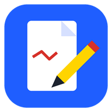

<p align="center">
  
</p>

<h1 align="center">PDF Kalemi</h1>

<p align="center">
  Kalemle PDF üzerine yazma, ders anlatma ve sunum uygulaması.<br>
  Surface Pen ve S Pen için baskıya duyarlı, mürekkep hissi veren bir kalem; bir de sesle soru sorulabilen yapay zekâ asistanı.
</p>

<p align="center">
  <a href="https://ufukasia.github.io/pdf-kalemi/"><b>🌐 Tarayıcıda aç</b></a> ·
  <a href="#kurulum">Kurulum</a> ·
  <a href="#ozellikler">Özellikler</a> ·
  <a href="#gizlilik-ve-api-anahtarlari">Gizlilik</a>
</p>

---

## Neden?

Derste beamer slaytlarının üzerine kalemle yazıp çizmek, slaytlar arasında hızla gezinmek ve aynı dosyayı tablette, telefonda ya da başka bir bilgisayarda açabilmek için yapıldı. Ana hedef, **kâğıda dolma kalemle yazıyormuş gibi hissettiren bir kalem.**

Uygulama iki biçimde çalışır:

| | Masaüstü (Windows) | Web / PWA |
|---|---|---|
| Nerede | Surface Pro 11 (ARM64), diğer Windows PC'ler | Android telefon/tablet, her tarayıcı |
| PDF'leri bu uygulamayla açma | ✅ Varsayılan uygulama olabilir | ✅ Kurulu PWA'da (Edge/Chrome) |
| Çevrimdışı | ✅ | ✅ Hizmet çalışanı ile |
| Yerel ses modelleri (Whisper / Piper) | ✅ | — |
| Klasör ekleme | ✅ | ✅ Destekleyen tarayıcılarda |

## Özellikler

### ✒️ Kalem
- **Baskıya duyarlı mürekkep:** çizgi baskıya, hıza ve yöne göre incelip kalınlaşır. Başlangıç ve bitişler sivrilir.
- **Uç tipleri:** tükenmez, dolma kalem, kaligrafi (yatık uç), fırça.
- Fosforlu kalem, düz çizgi, ok, dikdörtgen, elips ve silgi. Silgi, kalemin arka ucuyla da çalışır.
- **Neon lazer kalemi:** sunumda dikkat çekmek için parlayan, birkaç saniyede kaybolan iz.
- Düşük gecikme: `pointerrawupdate` ve senkronsuz çizim yüzeyleri kullanılır. "Parmakla çiz" kapalıyken parmak yalnızca kaydırır ve yakınlaştırır, sadece kalem yazar.

### ✂️ Seç, taşı, döndür, boyutlandır
- **Kalemin yan tuşuna basılı tutarak** (ya da farenin sağ tuşuyla) yazılanların çevresine bir alan çizin. Çizgilerin yarısından fazlası alanın içinde kalırsa seçilir.
- Seçimin içinden tutup **sürükleyin**.
- **Sağ üst köşedeki** tutamaçla **döndürün**: 90°'nin katlarına yaklaşınca yapışır.
- **Diğer köşelerdeki** tutamaçlarla **büyütüp küçültün**: çizgi kalınlığı da orantılı değişir.
- `Delete` seçimi siler, `Esc` seçimi kaldırır. Hepsi geri alınabilir.
- Ayarlardan yan tuşu silgi olarak da kullanabilirsiniz.

### 🖥️ Sunum
- Slayt slayt sunum kipi; sayfalar arasında boşluk yoktur.
- **Parmakla tek dokunuş ileri, çift dokunuş geri.** Ayarlardan kapatılabilir.
- PDF içindeki **bağlantılar ve içindekiler** (outline) doğru yere götürür; `Alt+←` ile geri dönülür.
- Sayfa numarasına git (`G`).

### 🗂️ Çekmeceler
Kenarlardan çekerek açılırlar:

| Kenar | İçerik |
|---|---|
| ⬇️ Üst | Kalem araç çubuğu (tek satır). 📌 ile sabitlenebilir. |
| ➡️ Sol | İki sekme: **Klasörlerim** (varsayılan) ve **Son açılanlar**. Klasörlere istediğiniz adı verebilirsiniz (ör. *Mat1*). OneDrive klasörleri de eklenebilir. |
| ⬅️ Sağ | Tüm sunumu küçük resimlerle gösteren film şeridi |
| ⬆️ Alt | **Ayarlar:** parmak, sunum, kalem, yapay zekâ, ses, sistem, görünüm |

### 🤖 Yapay zekâ asistanı
- Ekranda gezdirilebilen bir **balon**: basın, sorunuzu sesle sorun (ya da yazın).
- O anki sayfanın görüntüsü ve sorunuz **OpenRouter** üzerindeki **ücretsiz** görüntü modellerine gider. Bir model yanıt vermezse sıradakine geçilir.
- **Hiçbir şey siz "Gönder"e basmadan gitmez.** Önce ne gönderileceğini görür, sesi yeniden kaydedebilir ya da iptal edebilirsiniz.
- Yanıt sesli okunur.

### ✳️ Yapay zekâya aktar balonu (API anahtarı gerekmez)
- İkinci bir balon: **Claude, ChatGPT, Gemini, Antigravity ya da Codex**. Hangisi olacağı Ayarlar'dan seçilir; balon o yapay zekânın renginde olur ve altında adı yazar. Sürüklenip istenen yere konur, kısayolu `C`.
- Basınca o anki sayfa panoya kopyalanır ve seçilen yapay zekâ açılır. Kalemle bir alan seçiliyse yalnızca o alan kopyalanır.
- Uygulaması bilgisayarda kuruluysa (Başlat menüsünde bulunursa) uygulama, değilse sitesi tarayıcıda açılır: claude.ai, chatgpt.com, gemini.google.com, chatgpt.com/codex. Claude uygulaması doğrudan yeni bir sohbetle açılır. Antigravity'nin sitesi olmadığından yalnızca kuruluysa açılır.
- Masaüstünde yapay zekâ açılıp öne gelince görüntü **yazma kutusuna kendiliğinden yapıştırılır** (klavye gerekmez; Ayarlar'dan kapatılabilir). Siz sorunuzu yazarsınız ya da sesli modda söylersiniz. **Gönder'e her zaman siz basarsınız.** Kendi aboneliğinizle, o yapay zekânın kendi penceresinde çalışır.
- Android uygulamasında ve tabletlerde balon Paylaş menüsünü açar; istediğiniz uygulamayı seçtiğinizde görüntü ekli olarak gelir.

### 🔊 Ses servisleri
Ses servisleri Ayarlar → Ses bölümünden seçilir. Her servisin yanında "API anahtarı nedir, nasıl alınır?" açıklaması bulunur.

| Servis | Konuşmayı anlama | Seslendirme | Ücret |
|---|---|---|---|
| **Azure Speech** (varsayılan) | ✅ | ✅ Doğal Türkçe sesler (Emel, Ahmet…) | Ücretsiz katman: aylık 5 saat tanıma ve 0,5 milyon karakter seslendirme |
| ElevenLabs | — | ✅ En insansı ses | Sınırlı ücretsiz kullanım, sonrası ücretli |
| Yerel (yalnız masaüstü) | ✅ Whisper small | ✅ Piper (tr_TR) | Ücretsiz, internetsiz |
| Tarayıcı | ✅ | ✅ Sistem sesleri | Ücretsiz |

### 💾 Kaydetme
- Mürekkep her dosya için otomatik saklanır ve kaldığınız sayfadan devam edilir.
- **PDF olarak dışa aktarma** vektörel yapılır: yazılar büyütüldüğünde bulanıklaşmaz.

## Kısayollar

| Tuş | İşlem |
|---|---|
| `P` `H` `L` `A` `R` `O` `E` `Z` | Kalem, fosforlu, çizgi, ok, dikdörtgen, elips, silgi, lazer |
| `1` `2` `3` `4` | Uç: tükenmez, dolma kalem, fırça, kaligrafi |
| `Y` / `C` | Asistan balonu / Yapay zekâya aktar balonu |
| `T` | Üst araç çubuğunu aç/kapat |
| `→` / `PageDown` / `Boşluk` | Sonraki sayfa |
| `←` / `PageUp` | Önceki sayfa |
| `Home` / `End` | İlk / son sayfa |
| `G` | Sayfaya git |
| `Alt+←` / `Alt+→` | Bağlantıdan geri / ileri |
| `+` / `-` / `0` | Yakınlaştır / uzaklaştır / genişliğe sığdır |
| `Ctrl+Z` / `Ctrl+Y` | Geri al / ileri al |
| `Ctrl+S` / `Ctrl+O` | PDF olarak kaydet / dosya aç |
| `Delete` / `Esc` | Seçimi sil / seçimi bırak |

## Kurulum

### Telefon ve tablet (Android)
**Android uygulaması (APK):** `PDF-Kalemi-android.apk` dosyasını telefona aktarıp açın (OneDrive, kablo ya da e-posta ile). İlk kurulumda Android "bilinmeyen kaynaklardan uygulama yükleme" izni ister. Bu, Play Store dışından kurulan her uygulama için istenen izindir.
- İnternetsiz çalışır; uygulamanın bütün dosyaları içindedir.
- Dosya yöneticisinde bir PDF'e dokununca **"PDF Kalemi ile aç"**, başka bir uygulamada **"Paylaş → PDF Kalemi"** çıkar.
- **Klasörlerim**, Android'in klasör seçicisiyle çalışır; seçilen klasörün izni kalıcıdır.
- Kaydetme ve aktar balonu Android'in paylaş menüsünü açar (OneDrive, Drive, Claude, ChatGPT, Gemini…).
- S Pen basıncı ve yan tuşu desteklenir; Android 7 ve sonrası.

**Ya da tarayıcıdan:** Chrome veya Samsung Internet ile **https://ufukasia.github.io/pdf-kalemi/** adresini açıp menüden **"Uygulamayı yükle"** seçeneğine dokunun.

### Windows
| Dosya | Bilgisayar |
|---|---|
| `PDF-Kalemi-Kurulum-arm64.exe` | ARM işlemcili (Surface Pro 11, Snapdragon) |
| `PDF-Kalemi-Kurulum-x64.exe` | Intel / AMD işlemcili (çoğu bilgisayar) |
| `PDF-Kalemi-arm64.exe`, `PDF-Kalemi-x64.exe` | Kurulum gerektirmeyen taşınabilir sürümler |

Kurulum tek tıklıdır ve yönetici izni istemez. Ayarlar → Sistem bölümünden PDF Kalemi'ni **PDF dosyaları için varsayılan uygulama** yapabilirsiniz.

### Hepsini derlemek

```bash
npm install
npm run dist:all       # Windows ARM64 + x64 ve Android APK → dist/
npm run dist:win       # yalnız Windows (ARM64 + x64)
npm run dist:android   # yalnız Android APK
```

- Derleme, Windows'un yol uzunluğu sınırına ve Gradle'ın Türkçe karakterli yollardaki sorunlarına takılmamak için kısa klasörlerde yapılır (`%LOCALAPPDATA%Temppkb`, `pka`). Çıktılar proje içindeki `dist/` klasörüne kopyalanır.
- Android için gereken Java 21 ve Android SDK yoksa ilk derlemede kendiliğinden `%LOCALAPPDATA%pk-android` klasörüne indirilir. Android Studio gerekmez.
- **APK imza anahtarı depoda değildir.** İlk derlemede `%USERPROFILE%.pdfkalemi` klasöründe oluşturulur. Bu klasörü yedekleyin: güncellemeler aynı anahtarla imzalanmalıdır; anahtar kaybolursa telefondaki uygulamanın silinip yeniden kurulması gerekir.

### Geliştirme

```bash
npm install
npm start           # Electron ile çalıştır
```

Web sürümü için klasörü herhangi bir statik sunucuyla açmanız yeterlidir (ör. `npx serve .`). Hizmet çalışanı yalnızca `https` ve `localhost` üzerinde etkinleşir.

## Proje yapısı

```
index.html            Arayüz, çekmeceler, ayarlar
app.js                PDF görüntüleme, mürekkep motoru, seçim, sunum, dışa aktarma
ai.js                 Yapay zekâ asistanı (balon, kayıt, inceleme, OpenRouter)
aktar.js              Aktar balonu (görüntüyü panoya kopyalar; Claude, ChatGPT, Gemini, Antigravity, Codex'i açar)
speech.js             Ses servisleri (Azure, ElevenLabs, tarayıcı)
web.js                Web/PWA ve Android için masaüstü köprüsünün karşılığı (IndexedDB, dosya erişimi, Capacitor)
sw.js                 Çevrimdışı önbellek
main.js / preload.js  Electron ana süreci ve güvenli köprü
voice.js              Yerel Whisper ve Piper modelleri (masaüstü)
build/                Windows simgesi ve kurulum betiği (PDF ilişkilendirme)
lib/                  pdf.js ve pdf-lib
scripts/dist.js       Tek komutla bütün kurulum dosyaları (Windows ARM64 + x64, Android)
mobile/               Android uygulaması: Capacitor projesi, yerel eklenti (birlikte aç, klasörler), APK derleme betiği
```

## Gizlilik ve API anahtarları

- **Bu depoda hiçbir API anahtarı yoktur.** OpenRouter, Azure ve ElevenLabs anahtarlarını her kullanıcı kendisi alır ve Ayarlar'dan girer.
- Anahtarlar **yalnızca kendi cihazınızda** saklanır (tarayıcı/uygulama yerel depolaması). Hiçbir sunucuya kaydedilmez ve yalnızca ilgili servise doğrudan gönderilir.
- PDF'leriniz ve mürekkebiniz cihazınızda kalır. Bulut eşitlemesi istiyorsanız dosyalarınızı OneDrive gibi bir klasörde tutabilirsiniz.
- Dışarıya giden veriler yalnızca şunlardır:
  - siz **Gönder**'e bastığınızda sayfa görüntüsü ve sorunuz → OpenRouter;
  - ses tanıma ya da seslendirme için ses veya metin → seçtiğiniz servis (Azure / ElevenLabs).
- Yerel ses kipinde hiçbir ses verisi cihazdan çıkmaz.

> Kendi çatalınızı (fork) yayımlıyorsanız anahtarlarınızı asla koda ya da `.env` dosyasına yazıp depoya göndermeyin.

## Kullanılan açık kaynaklar

- [pdf.js](https://github.com/mozilla/pdf.js) (Apache-2.0): PDF görüntüleme
- [pdf-lib](https://github.com/Hopding/pdf-lib) (MIT): PDF dışa aktarma
- [Electron](https://www.electronjs.org/) (MIT) ve [electron-builder](https://www.electron.build/) (MIT)
- [Capacitor](https://capacitorjs.com/) (MIT): Android uygulaması
- [Transformers.js](https://github.com/huggingface/transformers.js) (Apache-2.0) ve ONNX Runtime (MIT): yerel Whisper
- [Piper](https://github.com/rhasspy/piper) ve espeak-ng: yerel Türkçe seslendirme. Modeller ilk kullanımda indirilir ve kendi lisanslarına tabidir.

## Lisans

MIT © Ufuk ASIL
